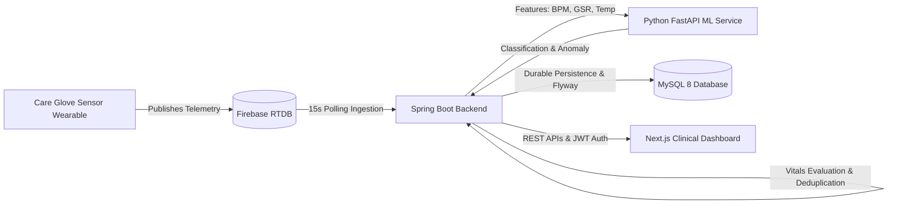

# CARE-GLOVE AI — Smart Wearable Physiological Monitoring System

CARE-GLOVE AI is an end-to-end clinical telemetry and statistical risk-monitoring platform. It continuously connects physical smart glove wearables publishing to Firebase Realtime Database with a Java Spring Boot backend, a Python machine learning scoring service, a persistent MySQL 8 clinical database, and a Next.js clinical dashboard.

---

## 1. Architecture & Complete Data Flow



1. **Hardware / IoT Source**: Smart glove hardware publishes telemetry to Firebase Realtime Database.
2. **Firebase Ingestion**: The Spring Boot backend continuously ingests readings from `/sensorData` (live latest readings) and `/sensorHistory` (chronological push records).
3. **Validation & Normalization**: Data is normalized to 3 primary signals (`heart_rate`, `gsr`, `temperature`) and validated against physiological boundaries.
4. **Machine Learning Scoring**: Features are evaluated by the FastAPI ML service using robust baseline MAD z-scores and an `ExtraTreesClassifier` trained model.
5. **Vital Threshold Evaluation & Alert Lifecycle**:
   - Evaluates incoming vitals against warning and critical thresholds.
   - Prevents duplicate alerts for recurring readings.
   - Escalates alert severity when vitals worsen.
   - Automatically resolves open alerts when vitals return to normal range.
6. **Durable Persistence**: Sensor readings, ML predictions, patient journey timeline milestones, deduplicated alerts, and notifications are saved in MySQL.
7. **Continuous Monitoring & Stale Detection**: A dedicated scheduler runs every 15 seconds, maintaining sliding window statistics, alert state management, and stale/disconnected device detection.
8. **Frontend Dashboard**: Preserved Next.js clinical interface retrieves real-time patient status, vitals, alerts, notifications, and patient journey history via typed REST APIs.

---

## 2. Physiological Parameters & Thresholds

| Parameter | Unit | Normal Range | Warning Threshold | Critical Threshold |
|---|---|---|---|---|
| **Heart Rate** | BPM | 50 – 120 | < 50 or > 120 | < 45 or > 140 |
| **Temperature** | °C | 35.5 – 38.0 | < 35.5 or > 38.0 | < 34.0 or > 39.5 |
| **GSR (Conductance)** | µS | 0.1 – 10.0 | > 10.0 | > 12.0 |

*Note: Research prototype reference ranges. Not clinically validated as a diagnostic medical device.*

---

## 3. Technology Stack

- **Frontend**: Next.js 16 (App Router, Turbopack), React 19, TypeScript, Tailwind CSS, Lucide Icons
- **Backend**: Java 21, Spring Boot 3.5.7, Spring Data JPA, Spring Security, JWT, Flyway Migration
- **ML Service**: Python 3.10+, FastAPI, Uvicorn, Scikit-learn (ExtraTreesClassifier), NumPy, Pandas
- **Database**: MySQL 8.0 (default port 3307, database `careglove_db`)
- **IoT Telemetry**: Firebase Realtime Database (REST API polling / incremental sync)

---

## 4. Repository Structure

```text
CARE-GLOVE-AI/
├── app/                  # Next.js App Router (dashboard, monitoring, alerts, auth)
├── backend/              # Spring Boot Java application
│   ├── src/main/java/    # Ingestion, alerting, vitals, security, domain entities
│   ├── src/main/resources/ # application.yml, Flyway migrations (V1-V6)
│   ├── src/test/java/    # Integration & pipeline test suites
│   └── pom.xml           # Maven project configuration
├── components/           # React UI components (timeline, instructions, vitals)
├── lib/                  # Frontend services, API client, clinical adapters, domain models
├── ml-service/           # Python FastAPI machine learning service
│   ├── src/              # Feature processing, anomaly detection, model scoring
│   ├── artifacts/        # Trained model and synthetic scenario dataset
│   └── requirements.txt  # Python dependencies
├── public/               # Static assets & icons
├── .env.example          # Environment configuration template
├── package.json          # Node.js dependencies & scripts
└── README.md             # Project documentation
```

---

## 5. Prerequisites

- **Java**: OpenJDK 21
- **Maven**: 3.9+
- **Python**: 3.10+ with `virtualenv`
- **Node.js**: v18+ / v20+ with `pnpm`
- **MySQL**: MySQL 8.0 running on port 3307

---

## 6. Installation and Execution

### Step 1: Clone and Configure Environment

```bash
git clone https://github.com/JNK1305/CARE-GLOVE-AI.git
cd CARE-GLOVE-AI
cp .env.example .env
```

Ensure MySQL has database `careglove_db` created:
```sql
CREATE DATABASE IF NOT EXISTS careglove_db;
```

### Step 2: Start the Python ML Service

```bash
cd ml-service
python -m venv .venv
source .venv/bin/activate  # On Windows: .\.venv\Scripts\Activate.ps1
pip install -r requirements.txt
python -m uvicorn src.main:app --host 127.0.0.1 --port 8001
```
Health Check: `http://127.0.0.1:8001/ready`

### Step 3: Start the Spring Boot Backend

```bash
cd backend
mvn spring-boot:run
```
- Health Check: `http://127.0.0.1:8080/api/system/status`
- Swagger UI: `http://127.0.0.1:8080/swagger-ui.html`

### Step 4: Start the Next.js Frontend

```bash
# In the root project directory:
pnpm install
pnpm dev
```
Open `http://localhost:3000` in your browser.

---

## 7. Verification and Testing

All automated test suites pass across all layers:

- **Backend Maven Tests**:
  ```bash
  mvn -f backend/pom.xml test
  ```
  Result: **32/32 tests passed** (Alert pipeline integration, continuous monitoring, Firebase ingestion, doctor notes, auth).
- **Frontend Tests**:
  ```bash
  pnpm test
  ```
  Result: **12/12 passed** (Vitest clinical ranges, monitoring adapters).
- **Frontend Type Check & Build**:
  ```bash
  pnpm exec tsc --noEmit
  pnpm build
  ```
  Result: **0 errors, compiled successfully**.
- **ML Service Tests**:
  ```bash
  pytest ml-service/tests
  ```
  Result: **11/11 passed**.

---

## 8. Security & Disclaimers

1. **Authentication**: JWT token-based authentication with role-based access control (`admin`, `senior`, `duty`).
2. **Prototype Notice**: Research prototype platform. Thresholds and statistical machine learning scoring are intended for research simulation and clinical decision support triage, not autonomous diagnosis.
3. **Sensor Disconnection Detection**: Detached sensors (`gsr_raw >= 4090` or `ir < 15000`) are flagged as `INSUFFICIENT_DATA` rather than silently misclassified as normal readings.

---

## 9. License

This project is licensed under the MIT License.
